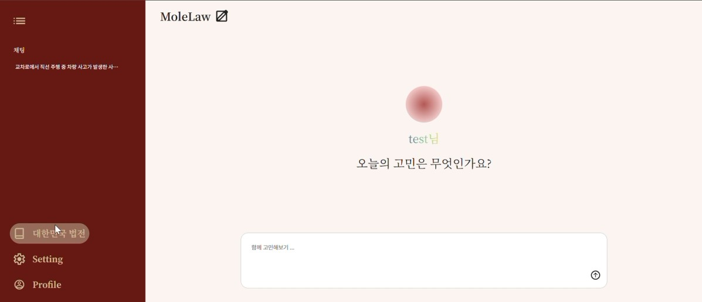

# 김정현 | Java·Spring 백엔드 개발자

Java와 Spring으로 인증과 데이터 조회 API를 개발했습니다. 법률 상담 서비스 MoleLaw에서 법령 검색을 맡았고, 개인 재구축에서는 검색이 놓친 근거를 다음 설계와 평가에 반영하고 있습니다.

[이력서](이력서_김정현.md) · [상세 포트폴리오](포트폴리오_김정현.md) · [이메일](mailto:richard.kim146@gmail.com)

## 목차

[주요 기술](#주요-기술) · [대표 프로젝트](#대표-프로젝트) · [보조 프로젝트](#보조-프로젝트)

## 주요 기술

| 기술 | 이해하고 사용한 범위 |
| --- | --- |
| Java · Spring Boot · Spring MVC | 요청 검증, 컨트롤러·서비스·저장소의 역할 분리, 입력 스트림을 이용한 파일 응답까지 구현했습니다. |
| Spring Data JPA · Oracle · MySQL | 엔티티 관계와 조건 조회를 다루고, DB별 데이터소스·영속성 컨텍스트·트랜잭션 매니저를 구성했습니다. |
| Spring Security · OAuth2 · JWT · Redis | 외부 로그인 결과와 서비스 가입 상태를 연결하고, Access 검증과 Refresh 회전·폐기를 구현했습니다. |
| Spring AI · Qdrant · OpenAI API | 모델 호출, 임베딩, 벡터 후보 검색, 도구 호출을 연결하고 후보 재정렬과 추가 검색을 따로 평가했습니다. |
| Prometheus · Grafana | 모델 호출 지연과 대기 만료를 관측하고 단독·혼합 부하에서 요청 결과를 비교했습니다. |

[기술별 이해와 구현 범위](포트폴리오_김정현.md#주요-기술)

## 대표 프로젝트

### MoleLaw · AI 법률 상담 서비스

법률 질문에 답할 때 관련 조문과 출처를 함께 제공하는 서비스입니다.

- **팀 개발** — 4명 팀의 팀장으로 요구사항과 기능을 설계하고, 법령 임베딩 검색을 맡았습니다. 팀원과 답변 생성부를 개발하고 검색된 조문을 답변과 참고자료에 연결했습니다.
- **개인 재구축** — Spring AI와 Qdrant로 검색 흐름을 다시 구성했습니다. 후보의 순서를 바꾸는 실험과 빠진 근거를 추가 검색하는 실험을 진행했고, 개발 브랜치에서 법령 수집을 검색 도구로 호출하도록 변경했습니다.

[▶ MoleLaw 구동 영상](https://drive.google.com/file/d/1ZUu3FD2njk2aI4vAd9R_jOb5f5j6t2xe/view?usp=drive_link) · [설계와 실험 결과](포트폴리오_김정현.md#molelaw) · [팀 저장소](https://github.com/24Sahmyook-Team-s1/MoleLaw_backend) · [개인 개발 브랜치](https://github.com/ranpia/MoleLaw_backend/tree/dev)

## 보조 프로젝트

| 프로젝트 | 주요 작업 | 더 보기 |
| --- | --- | --- |
| Molecom | Oracle의 영상 메타데이터와 SMB의 DICOM 파일을 조회 API로 연결하고, 사용자·로그 데이터는 MySQL에 저장했습니다. | [상세 사례](포트폴리오_김정현.md#molecom) |
| AI Diary | Google 로그인 후 추가 가입 정보를 입력하는 흐름을 구현하고, 상담기관 검색 조건과 월 단위 수집 일정을 추가했습니다. | [상세 사례](포트폴리오_김정현.md#ai-diary) |
| ThinkTrip | 소셜 로그인과 JWT 인증을 연동하고 월 경계를 넘는 여행 일정의 D-Day 계산을 수정했습니다. | [보조 프로젝트](포트폴리오_김정현.md#보조-프로젝트) |
| MolePMS | JSP 일정·간트 차트 기능을 맡아 프로젝트별 일정 조회를 연결했습니다. | [조회 변경 커밋](https://github.com/ranpia/molepmsporject/commit/542e925) |
| Fruit Box AI | OpenCV로 게임 보드를 인식하고 Selenium 자동화와 숫자 인식 모델을 실험했습니다. | [숫자 인식 변경 커밋](https://github.com/ranpia/applegame/commit/bf1a4fc) |
