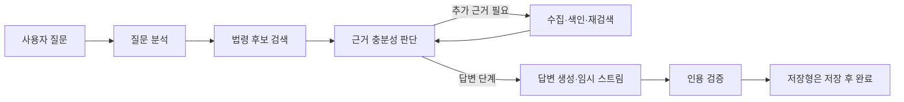

# 김정현 | 백엔드 포트폴리오

Java·Spring 백엔드 포트폴리오입니다. MoleLaw의 법령 검색과 실험을 중심으로, Molecom의 다중 DB 조회와 AI Diary의 로그인·검색 구현을 정리했습니다.

[GitHub](https://github.com/ranpia) · [이력서](이력서_김정현.md) · [Email](mailto:richard.kim146@gmail.com)

## 목차

- [주요 기술](#주요-기술)
- [대표 프로젝트 · MoleLaw](#molelaw)
- [주요 프로젝트 · Molecom](#molecom) · [AI Diary](#ai-diary)
- [보조 프로젝트](#보조-프로젝트)

## 주요 기술

| 기술 | 이해하는 개념 | 구현해 본 범위 |
| --- | --- | --- |
| Java · Spring Boot · Spring MVC | 요청 검증, 계층별 책임, 일반 응답과 스트리밍 응답의 차이 | 요청 DTO 검증과 컨트롤러·서비스·저장소를 구성했습니다. 저장소에서 읽은 파일을 `StreamingResponseBody`로 전송했습니다. |
| Spring Data JPA · Oracle · MySQL | 엔티티 연관관계와 API 응답 형태, 데이터소스·영속성 컨텍스트·트랜잭션 매니저의 관계 | 일대다 조회를 목록 응답으로 연결하고 Specification으로 조건을 조합했습니다. Oracle·MySQL별 JPA 설정을 구성하고 메타데이터 조회에 읽기 전용 트랜잭션을 지정했습니다. |
| Spring Security · OAuth2 · JWT · Redis | 외부 인증과 서비스 가입의 관계, Access와 Refresh의 수명과 폐기 방식 | Google 로그인과 신규 가입의 추가 입력을 연결했습니다. Access JWT 검증과 Redis·Lua 기반 Refresh 회전·폐기를 구현했습니다. 기존 Access는 로그아웃 후에도 만료까지 최대 5분 유효할 수 있습니다. |
| Spring AI · Qdrant · OpenAI API | 모델 호출·대화 맥락·도구 호출의 역할, 임베딩 후보 검색과 재정렬의 차이 | 모델 호출과 법령 검색 도구, Qdrant 후보 조회를 연결했습니다. 고정 질문셋에서 후보 재정렬과 반복 검색을 각각 평가했습니다. |
| Prometheus · Grafana | 요청 지연과 실패 지표를 읽고 실행 시간과 대기 만료를 구분하는 방법 | 모델 단독·혼합 호출을 관측하고 대기 시간 초과를 확인했습니다. 검증 범위는 별도 부하 환경의 구성요소 시험까지입니다. |
| GitHub Actions | 워크플로에 정의된 실행 단계와 배포 환경 설정의 연결 | 기존 배포 워크플로의 경로와 환경 변수 전달 설정을 수정했습니다. |

## MoleLaw | AI 법률 상담 서비스

**대표 프로젝트 · 팀 개발 2025.06–07 · 개인 재구축 2026.10–진행 중**

| 구분 | 맡은 작업 | 확인한 결과 |
| --- | --- | --- |
| 팀 개발 · 4명 | 팀장, 법령 검색 담당, 답변 생성부 공동 개발 | 검색한 조문을 모델 입력과 참고자료에 연결 |
| 개인 재구축 | 검색·재검색, 검색 평가, 상담 스트림과 인증 | 후보 재정렬과 추가 검색의 결과를 별도로 비교 |

### 문제와 사용자

**대상 사용자** · 일상에서 법률 문제가 생겼을 때, 법률 용어나 조문 번호를 몰라도 자기 상황을 설명하고 관련 근거를 확인하고 싶은 사람입니다.

**해결하려던 문제** · 팀은 사용자가 평소 쓰는 말로 질문하면 관련 법령과 판례를 찾아 답변과 참고자료를 함께 보여주는 상담 흐름을 구상했습니다. 제가 맡은 과제는 질문과 관련된 조문을 검색하고, 검색 결과가 실제로 답변과 참고자료에 전달되도록 연결하는 일이었습니다.

### 2025년 팀 개발과 검색 근거 전달

팀장 · 총 4명(프론트엔드 1명, 백엔드 3명) · 요구사항 분석·전체 기능 설계·백엔드 개발

팀 개발에서는 RAG를 주로 담당했습니다. 법령·질문 임베딩 처리와 코사인 유사도 검색을 구현했으며, 답변 생성부인 `FinalAnswer`는 팀원과 같은 화면을 보며 로직을 논의하고 함께 개발·수정했습니다. 이 과정에서 검색 결과 전달 로직 개선에도 참여했습니다. JWT 인증 등 다른 영역은 팀원이 구현한 기능을 통합하면서 필요한 부분을 수정하고 처리 방식을 논의했습니다.

### 트러블슈팅: 검색한 법령이 답변 생성에 반영되지 않는 흐름

**발견** · 답변에 사용한 근거를 Markdown 참고자료로 정리하는 작업을 하다가, 답변은 생성되지만 검색한 법령이 실제 근거로 전달되지 않는 현상을 발견했습니다.

**원인** · 답변과 Markdown 참고자료를 분리한 뒤 코드를 보면, 유사도 검색 결과는 `topChunks`에 있었지만 모델 입력과 참고자료를 만들 때는 별도의 빈 `lawResults`를 사용하고 있었습니다. 이 경로에서는 검색을 마쳐도 모델이 검색한 조문 본문을 받지 못했습니다. [답변과 Markdown 참고자료 분리](https://github.com/24Sahmyook-Team-s1/MoleLaw_backend/commit/846a4aa)

**수정과 결과** · 프롬프트 구성과 Markdown 생성이 모두 `topChunks`를 사용하도록 수정했습니다. 검색한 조문의 본문은 모델 입력에 전달하고, 참고자료의 법령명과 조문·링크도 같은 검색 결과에서 구성하도록 연결했습니다. 확인한 결과는 코드에서 근거 전달 경로가 연결된 범위입니다. [검색한 조문을 두 경로에 연결](https://github.com/24Sahmyook-Team-s1/MoleLaw_backend/commit/e1efafe)

### 구현 개선: 이미 저장한 청크의 임베딩 재처리

**검토한 지점**

병렬 임베딩 작업에서 청크 객체의 연관 상태를 확인하는 것과 실제 저장소에 임베딩이 존재하는지 확인하는 것을 구분할 필요가 있었습니다.

**수정**

병렬 작업 내부에 `existsByLawChunk()` 조회를 추가하고 이미 임베딩이 저장된 청크는 외부 API 호출과 저장을 건너뛰도록 했습니다.

**적용 범위**

작업 스레드는 청크마다 저장 여부를 조회하고, 이미 임베딩이 있는 청크는 모델 호출과 저장 단계에 들어가지 않습니다. 존재 확인과 저장은 각각 수행하므로, 두 작업이 같은 청크를 동시에 조회하는 경우는 이 검사만으로 제어할 수 없습니다.

근거: [저장소 확인과 중복 스킵 · 9386cc9](https://github.com/ranpia/MoleLaw_backend/commit/9386cc9)

### 개인 재구축의 설계 흐름

**재구축을 시작한 이유** · 팀 개발의 `FinalAnswer`에는 검색한 조문을 다루는 코드와 프롬프트 구성, 모델 호출, 참고자료 생성이 함께 있었습니다. 검색 결과 목록을 구한 뒤 프롬프트에서는 별도의 빈 목록을 사용했던 문제도 이 흐름에서 발견했습니다. 개인 재구축에서는 교육에서 배운 Spring AI의 `ChatClient`를 적용하고, 검색이나 답변 형식을 바꿀 때 수정 범위를 좁힐 수 있도록 로직을 책임별로 나누고 싶었습니다.

| 책임 | 재구축에서 맡긴 일 |
| --- | --- |
| 모델 호출 | `AiChatService`에서 `ChatClient`로 시스템 지시와 메시지를 전달하고, 구조화가 필요한 응답은 지정한 타입으로 받습니다. |
| 근거 수집 | 질문을 분석하고 법령 후보를 찾은 뒤, 근거가 부족하면 추가 검색에 필요한 도구를 호출합니다. |
| 답변 구성 | 수집한 근거로 프롬프트를 구성하고, 답변과 출처를 사용자에게 전달합니다. |

예를 들어 검색 도구의 선택과 실행은 수집 단계에서 다루고, 확보한 조문을 모델에 어떻게 보여줄지는 답변 단계에서 다룹니다. 이렇게 입력과 출력의 경계를 두는 것이 결합도를 낮추려던 목표를 코드로 옮긴 방식입니다.

[검색·수집·재검색 구현](https://github.com/ranpia/MoleLaw_backend/commit/b0b37d8) · [Spring AI 코드 구조 정리](https://github.com/ranpia/MoleLaw_backend/commit/d6cf789)

주요 책임을 요약한 흐름이며 예외·종료 조건은 생략했습니다. Spring AI는 모델 호출과 대화 맥락 복원에, Qdrant는 법령 벡터 검색에 사용합니다. 재정렬은 이미 찾은 후보의 순서를 바꾸므로, 후보 밖 근거를 찾는 추가 검색을 별도로 평가했습니다. 추가 검색은 호출 단계가 늘고, 공유 추론 자원은 긴 연산이 다른 요청의 대기에 영향을 주는 제약이 있어 품질과 지연을 나눠 기록했습니다.

### 개인 재구축: 검색 의도를 원문 조문에 연결하는 판단

법령 API에서 ‘민법’을 찾으면 ‘난민법’도 나오고, 모델이 실제로 존재하지 않는 조문을 제시할 수 있었습니다. 같은 법령 안에서도 조문마다 다루는 내용이 달라, 질문의 쟁점에 맞는 원문 조문을 찾는 방식을 택했습니다. 사용자 질문을 법률 쟁점으로 분석하고 실제 조문 원문에서 근거를 찾는 방향으로 구성했습니다. 사용자가 의도 후보를 고르는 구상은 2026년 재설계의 일부이며, 현재는 최초 추천 질문 API와 후속 질문·판례 계획을 나눠 처리합니다.

모델·청크 비교 후 별도 질문 평가에서 근거 회수 부족을 확인했습니다. 과거 원문 기반 확대 평가와 다른 질문셋의 점수를 같은 조건의 성능 하락으로 계산하지 않았고, 이후 결과를 보고 조정한 36문항은 튜닝 자료로 구분했습니다. 정답 일부를 찾는 Hit와 필요한 근거를 모두 찾는 Complete를 함께 확인하도록 평가 기준을 정리했습니다.

근거: [직접 설명한 설계 의도](docs/MoleLaw_공유대화_설계의도.md), [과거 평가 커밋 검토](docs/MoleLaw_커밋검토_실험.md).

### 개인 재구축: 법령 수집에 필요한 검색을 도구로 호출

**이 방식을 택한 이유** · 기존 수집 흐름에서는 서버 코드에 정해 둔 키워드 수를 기준으로 법령을 찾았습니다. 재구축에서는 질문과 지금까지 확보한 근거에 따라 LLM이 다음 검색이 필요한지, 어떤 도구를 어떤 인자로 호출할지 판단하는 에이전틱 AI 방식을 구현해 보고 싶었습니다.

**구현한 범위** · 법령 검색과 수집에 쓰는 서버 메서드를 모델이 호출할 수 있는 도구로 명시했습니다. 개발 브랜치의 `LawToolCallingPlanner`는 질문과 검색 계획, 실행 가능한 도구 목록을 `ChatClient`에 전달합니다.

1. 모델은 현재 확보한 근거를 바탕으로 사용할 도구의 이름과 인자를 반환합니다.
2. 서버는 도구 이름이 허용 목록에 있는지 확인하고, 등록된 메서드에 인자를 넘겨 실행합니다.
3. 실행 결과를 모델에 돌려주면 모델은 갱신된 근거를 바탕으로 다음 동작을 판단합니다.

이 구조에서는 모델이 검색에 필요한 동작을 고르고 서버가 실행 범위를 관리합니다. 수집 경로에서 합치는 검색 후보는 최대 15개이며, 호출 예산을 소진하면 근거 부족 상태를 반환합니다.

[법령 수집 도구 전환](https://github.com/ranpia/MoleLaw_backend/commit/0bf0dbd) · [도구 호출 수정](https://github.com/ranpia/MoleLaw_backend/commit/d45fa2f) · [Spring AI 코드 구조 정리](https://github.com/ranpia/MoleLaw_backend/commit/d6cf789)

### 검색 평가: 순위와 근거 누락

**관찰과 선택**

상위 5개와 넓은 후보의 회수율 차이를 보고, 넓은 후보에 있는 근거가 상위에서 밀리는 문제를 리랭커로 보완하려 했습니다. 이후 확인한 KURE 500문자·법률 쟁점 질의의 기준선은 Recall@5 31.39%·Recall@50 56.57%였습니다. 다만 이 차이를 리랭커의 개선 수치로 사용할 수 없으므로 10월 31일에 직접 비교를 추가했습니다.

**고정 후보의 재정렬 결과**

같은 36문항·정답·법률 쟁점 질의·dense50·대표 청크를 유지하고 현재 서비스의 BGE 리랭커로 순서만 바꿨습니다.

| 지표 | 적용 전 | 적용 후 | 판단 |
| --- | ---: | ---: | --- |
| Hit@5 | 20/36 | 22/36 | 일부 질문에서 정답의 상위 노출 증가 |
| Complete@5 | 4/36 | 4/36 | 필요한 근거 전체 확보는 증가하지 않음 |
| Recall@5 | 31.39% | 38.19% | 정답 근거 회수율 평균, 답변 정확도가 아님 |
| Recall@50 | 56.57% | 56.57% | 고정 후보 재정렬이므로 후보 밖 정답은 새로 회수하지 않음 |

같은 CPU 실행 조건의 리랭커 HTTP p95는 66.12초였고 일부 질문은 순위가 악화됐습니다. 이는 dense 검색·답변 생성·동시 부하를 포함하지 않으며 36응답 중 1개는 사전 smoke 캐시와 최초 시간을 재사용했습니다. 품질 지표만으로 지연과 개별 실패를 지우지 않았습니다.

**반복 검색의 후보 보완과 선택 누락**

이어 실제 서비스의 질문 분석·수집 조정 코드를 고정 코퍼스 어댑터에 연결하고, 같은 실행의 최초·종료 후보를 비교했습니다. 최대 15개 후보 기준 Hit는 19→26/36, Complete는 5→8/36이었습니다. 추가 검색한 8문항은 모두 최초 dense 후보 밖의 정답을 회수했습니다. 그러나 최종 선택은 Hit 25/36·Complete 7/36으로 종료 후보보다 낮았고, ANSWER_READY라도 정답 3개 중 2개만 선택한 사례가 있었습니다. 초기 분석 실패 5개와 근거 부족 1개도 분모에 남겼습니다.

따라서 후보를 확보하는 문제와 모델이 충분하다고 판단해 근거를 선택하는 문제를 분리했습니다. 이 실험은 실제 LLM·복수 질의·top15 조건이며 앞선 단일 질의 top5의 재정렬 효과와 직접 차감할 수 없습니다. 이미 튜닝한 36문항의 단회 검색 평가이며, 외부 법령 수집·색인·답변 생성·법률 정확도는 평가하지 않았습니다.

근거: [10월 31일 검색 평가와 고정 원자료 링크](docs/MoleLaw_커밋검토_20261031_검색평가.md).

### 부하 시험: 추론 대기와 요청 만료

**설계 의도**

법령 벡터를 계속 갱신하는 구조에서 문서·질문 임베딩이 같은 단일 추론 자원을 사용할 수 있다고 예상했습니다. 추론 자체를 무조건 병렬화하기보다 요청을 대기시켜 실패를 줄이는 데 목적을 뒀습니다. 공유 잠금으로 실제 추론은 1개만 실행하고 대기 슬롯 4개·5초 상한을 둬 실행과 수용을 분리했습니다.

**시험과 관측**

별도 부하 환경에 Prometheus·Grafana를 연결하고 조회 API·DB·Redis/Refresh·Qdrant·모델 단독·혼합·실제 답변 단계를 나눠 측정했습니다. 모델 서버의 CPU4·6GiB·float32 조건에서 임베딩 1개 worker와 리랭커 1개 worker, 후보5개로 120초 측정한 결과는 다음과 같습니다.

| 연산 | 요청 결과 | 관측 |
| --- | --- | --- |
| 질문 임베딩 | 33건 중 14건 대기 만료, 42.4% | 긴 리랭킹이 공유 잠금을 사용하는 동안 짧은 질문도 대기 제한 초과 |
| 리랭킹 | 20건 중 거부 0건 | 성공 응답 p95 9.472초 |

이 혼합 시험은 실제 모델 직접 호출이며 Qdrant 검색·신규 문서 적재·LLM은 실행하지 않았습니다. 따라서 실제 문서 재색인과 사용자 검색 전체가 함께 동작한 부하로 쓰지 않습니다. 또한 요청 수용 동시성은 모델의 병렬 추론 처리량이 아니며 제한된 메모리 대기열은 무손실·장애 복구를 보장하지 않습니다.

**다음 판단**

혼합 부하에서는 리랭킹이 공유 실행 슬롯을 점유하는 동안 질문 임베딩이 기다렸고, 대기 한도에 도달한 요청은 503 응답으로 종료됐습니다.

근거: [부하 조건·결과·구성요소별 검토](docs/MoleLaw_커밋검토_20261031_부하검증.md), [공유 대화의 의도](docs/MoleLaw_공유대화_설계의도.md).

### 개인 재구축: 임시 스트림과 검증된 저장을 구분

긴 최초 상담에는 SSE·NDJSON, 후속에는 NDJSON으로 진행 단계·임시 답변을 전달합니다. PREVIEW는 검증·저장이 끝난 근거가 아니므로 저장형은 인용 검증·저장 이후 SAVED·completed를, 무저장형은 검증 이후 completed를 전달합니다. 도구 진행 이벤트와 완료가 경쟁해 진행 메시지가 누락될 수 있는 구조는 같은 스트림 큐를 사용하도록 보완했습니다.

판례 검색의 의도는 최신 질문에서 판단하고 동의는 해당 요청의 명시 값으로 검사합니다. 단순한 ‘네’라는 승인문구가 원질문을 덮어쓰지 않도록 검색 주제를 복원하고, 사용자가 법령 맥락을 선택하지 않거나 여러 개 고르는 경우도 허용합니다. 긴 판결은 부분 발췌라고 표시하고 검색 미완료·본문 예산 제약을 판례 부재로 해석하지 않도록 했습니다. 대화 맥락은 MessageChatMemoryAdvisor로 복원하되 실행 권한·근거 검증은 서버가 맡습니다.

대역 시험에서는 동시 진입 제한·취소 후 슬롯 반환·오류 미저장을 확인한 기록이 있습니다. 취소가 공급자 계산의 즉시 종료를 보장하지는 않습니다. 작은 고정 색인 20조문·29청크를 이용한 실모델 무저장 RAG 첫 상담 1건에서는 첫 delta 39.002초·완료42.365초였지만, 저장형·신규 색인·전체 RAG 동시 부하·법률 답변 정확도 합격은 아닙니다.

근거: [상담 흐름·취소·이벤트 순서](docs/MoleLaw_커밋검토_20261031_상담흐름.md), [실모델·대역·부하의 검증 범위](docs/MoleLaw_커밋검토_20261031_부하검증.md).

### 개인 재구축: Refresh 폐기와 Access 인증의 의존성 분리

**문제와 설계 판단**

팀 개발 당시 인증 영역에서는 팀원 구현을 통합하면서 수정·논의했고, 이후 개인 재구축에서 기존 정책을 다시 검토했습니다. 초기 로그아웃은 쿠키만 삭제했으며 Refresh의 서버 폐기 상태가 없어 복사된 토큰으로 재발급할 수 있었습니다. 중간 단계에서 Access를 Redis에 등록·폐기하도록 바꿨지만, Refresh가 남아 있으면 다시 Access를 받을 수 있었고 일반 인증 요청도 Redis에 의존하게 됐습니다. 이에 Refresh의 회전·폐기는 서버가 관리하고 Access 검증의 Redis 의존성은 제거하는 방향으로 변경했습니다.

**수정**

Refresh를 난수 기반 토큰으로 바꾸고 Redis에 원문 대신 해시와 사용 이력을 저장했습니다. Lua로 현재 토큰을 소비·교체하고, 이미 소비한 토큰이 다시 제출되면 해당 로그인 family를 폐기하도록 했습니다. Access는 최대 5분 stateless JWT로 전환하고 issuer·audience·토큰 버전을 검증합니다.

**선택한 제약**

기존 Access 인증은 Redis를 조회하지 않지만 사용자 존재·권한 확인을 위한 MySQL 조회는 유지합니다. 로그아웃 후 복사된 Access는 만료까지 최대 5분 유효할 수 있습니다. Redis 장애 시 로그인·재발급·Refresh 폐기는 실패하며, 동시 회전이나 응답 유실 후에는 재로그인이 필요할 수 있습니다.

근거: [개선 전 인증 검토](https://github.com/ranpia/MoleLaw_backend/blob/61a4823/docs/jwt-security-review.md), [단계별 변경 이력](https://github.com/ranpia/MoleLaw_backend/blob/61a4823/docs/plans/auth-security.md), [Refresh 회전 · 0d3775c](https://github.com/ranpia/MoleLaw_backend/commit/0d3775c), [Access 전환 · 83ca4df](https://github.com/ranpia/MoleLaw_backend/commit/83ca4df)

### 단계별 구현과 코드 링크

팀 개발에서 겪은 검색·답변 연결 문제에서 출발해 개인 재구축에서는 호출 구조와 인증을 다시 설계하고 검색 평가까지 범위를 넓혔습니다.

| 단계 | 수행 내용 | 확인 범위 |
| --- | --- | --- |
| 2025년 팀 개발 | RAG 임베딩·검색, FinalAnswer 공동 개발·수정, 다른 기능 통합·논의 | 검색 청크 전달·답변과 참고자료 분리 등 코드 변경 |
| 2026년 개인 재구축 | 검색·수집·재검색, 상담 스트림·인증, 법령 수집 도구 전환 | [기본 브랜치 구현](https://github.com/ranpia/MoleLaw_backend/commit/b0b37d8) · [개발 브랜치 변경](https://github.com/ranpia/MoleLaw_backend/compare/b0b37d8...d6cf789) |
| 2026년 개인 검색 평가 | 모델·청크·독립 질문·리랭커·반복 검색 비교 | [검색 평가 커밋](https://github.com/ranpia/MoleLaw_backend/commit/3d9a7ab) |
| 2026년 부하 관측 | 조회·DB·인증·모델 직접 호출·혼합·작은 고정 RAG의 단계별 측정 | 조건별 지표와 실패를 기록, 전체 RAG 동시 부하와 구분 |

[팀 원본](https://github.com/24Sahmyook-Team-s1/MoleLaw_backend) · [개인 개발 브랜치](https://github.com/ranpia/MoleLaw_backend/tree/dev) · [개인 재구축 설계](docs/MoleLaw_개인재구축.md)

[검색 실험 브랜치](https://github.com/ranpia/MoleLaw_backend/tree/experiment/legal-embedding-evaluation)

## Molecom | DICOM 의료 영상 관리 서비스

### 문제와 사용자

**대상 사용자** · 환자의 과거 검사 이력과 DICOM 영상을 확인하는 의료진, 검사에 대한 소견을 남기는 담당 의사, 직원 계정을 발급하고 관리하는 관리자입니다.

**해결하려던 문제** · 팀은 별도 프로그램 설치 없이 웹에서 환자의 검사 목록을 찾고, 선택한 검사의 영상과 소견을 이어서 확인할 수 있도록 구상했습니다. 제가 맡은 과제는 읽기 전용 Oracle의 검사·영상 정보, SMB에 있는 실제 영상 파일, MySQL의 사용자·리포트·로그를 조회 흐름에 연결하는 일이었습니다.

**2025.08–09 · 집중 개발 약 1개월 미만**

팀장 · 총 4명(프론트엔드 1명, 백엔드 3명) · 요구사항 분석·전체 기능 설계·백엔드 개발

Oracle·MySQL의 조회와 트랜잭션 처리, DICOM 계층 조회·파일 스트리밍, 감사 로그 저장·조회 기능을 담당했습니다. 파일 응답은 Spring MVC의 `StreamingResponseBody`를 사용하며 SMB/CIFS 저장소와 연결합니다.

[저장소](https://github.com/24Sahmyook-Team-s1/Molecom_backend)

### 트러블슈팅: 환자의 여러 검사와 검사별 Series를 조회하도록 수정

**문제와 원인**

처음에는 영상 DB의 계층 관계를 제대로 파악하지 못했습니다. 뒤늦게 환자 한 명에게 여러 검사(Study)가 속할 수 있다는 점을 반영해 환자 ID로 검사 목록을 조회하도록 구현했습니다. 이어 검사별 조회에서도 하나의 Study에 여러 Series가 속하는데 API가 단일 `SeriesDto`를 반환하는 문제가 있었습니다. [환자별 검사 목록 구현](https://github.com/24Sahmyook-Team-s1/Molecom_backend/commit/5d95e6b) · [영상 계층 조회 추가](https://github.com/24Sahmyook-Team-s1/Molecom_backend/commit/2ec944a)

**수정**

Study UID로 Study를 찾은 뒤 `studyKey`에 속하는 Series 목록을 조회하도록 변경했습니다. 컨트롤러 응답도 `List<SeriesDto>`로 맞추고 Series는 `seriesNum`, Image는 `imageKey` 기준으로 정렬하도록 했습니다.

**변경 결과**

환자 ID로 검사 목록을 받은 뒤 검사 UID로 Series 목록을 조회할 수 있게 됐습니다. 선택한 Series의 이미지 목록도 정렬해 반환하도록 구성했습니다. 데이터베이스 조회에서 API 응답까지 각 단계에서 어떤 식별자로 다음 목록을 요청하는지 일치시켰습니다.

근거: [조회 계약·정렬 수정 · 95ff0aa](https://github.com/24Sahmyook-Team-s1/Molecom_backend/commit/95ff0aa)

### 리포트 설계: 한 검사에 의사의 소견을 모으기

팀에서는 한 번의 검사에 대한 의사의 판단과 소견을 검사 단위로 모아 볼 수 있어야 한다고 봤습니다. 영상 조회에서는 한 검사에 속한 Series를 목록으로 보여주고, 리포트는 검사 전체를 대상으로 하나씩 관리하도록 구조를 정했습니다.

Oracle의 검사 키를 MySQL 리포트에 저장하고, 리포트 엔티티에서 검사 키의 유일성 제약을 선언했습니다. 기존의 검사·Series별 리포트 목록 조회를 검사 키로 리포트 한 건을 조회하는 형태로 바꿨습니다. 저장 API도 같은 검사 키를 사용해, 리포트가 있으면 수정하고 없으면 새로 만들도록 구현했습니다. [검사와 리포트 관계 변경](https://github.com/24Sahmyook-Team-s1/Molecom_backend/commit/8f2c4eb)

### 협업 설계: 계정을 삭제해도 리포트 작성자 참조 유지

팀원과 사용자 삭제 방식을 깊게 논의했습니다. 환자 검사 리포트는 작성자 계정을 참조하므로, 계정을 물리적으로 지웠을 때 기존 리포트까지 영향을 받을 수 있다는 점을 고려했습니다. 삭제된 계정을 일반 목록에서 제외하면서 리포트가 참조하는 작성자 ID를 유지하는 것이 이 설계에서 중요했습니다.

팀원은 물리 삭제 API를 비활성화하고 사용자 행의 상태를 `DELETED`로 바꾸는 방식으로 구현했습니다. 기본 사용자 목록은 활성·비활성 상태만 조회하므로 삭제한 계정은 표시되지 않습니다. 기존 리포트가 참조하는 `author_id`는 그대로 유지됩니다. 사용자 목록에서 계정을 제외하는 규칙과 기존 기록에서 작성자를 보존하는 규칙을 함께 적용한 설계입니다.

[팀원의 계정 삭제 방식 변경](https://github.com/24Sahmyook-Team-s1/Molecom_backend/commit/5a59574) · [리포트 작성자 매핑](https://github.com/24Sahmyook-Team-s1/Molecom_backend/blob/a1e57d2/src/main/java/com/pacs/molecoms/mysql/entity/Report.java)

### 설계 개선: 감사 로그의 행위자·대상 구분

초기 사용자 로그의 단일 `user` 참조로는 작업을 수행한 사람과 변경 대상 사용자를 구분하기 어려웠습니다. 팀원과 처리 방식을 논의하고 `actor`·`target`을 분리했으며, 사용자 작업과 DICOM 열람 기록을 저장하도록 연결했습니다.

이후 사용자·리포트·DICOM 로그를 공통 DTO로 변환하고 생성 시각 내림차순으로 정렬했습니다. 이를 통해 유형마다 다른 로그를 한 응답에서 시간순으로 조회할 수 있게 구성했습니다.

근거: [행위자·대상 분리 · 2a43c4b](https://github.com/24Sahmyook-Team-s1/Molecom_backend/commit/2a43c4b), [DICOM 기록 · e6ad436](https://github.com/24Sahmyook-Team-s1/Molecom_backend/commit/e6ad436), [통합 조회 · a00d44d](https://github.com/24Sahmyook-Team-s1/Molecom_backend/commit/a00d44d)

### 트러블슈팅: 다중 DB 구성의 MySQL 설정 바인딩 불일치

**문제와 원인**

Oracle·MySQL을 함께 구성하는 과정에서 MySQL 데이터소스의 `@ConfigurationProperties` 경로가 사용하는 설정 경로와 맞지 않았습니다.

**수정**

MySQL 설정 바인딩을 `spring.datasource.mysql`에서 `spring.datasource`로 변경했습니다. DB별 데이터소스·EntityManagerFactory·트랜잭션 매니저를 분리하고 Oracle 조회에 `oracleTx`와 읽기 전용 트랜잭션을 지정했습니다.

**변경 결과**

MySQL 데이터소스가 실제 설정 경로에서 값을 읽도록 바인딩을 맞췄습니다. Oracle 메타데이터 조회에는 `oracleTx`를 명시하고, 사용자·리포트·로그는 MySQL 쪽 영속성 설정에서 처리하도록 분리했습니다.

근거: [DB별 구성 · ba76312](https://github.com/24Sahmyook-Team-s1/Molecom_backend/commit/ba76312), [바인딩 수정 · de8b487](https://github.com/24Sahmyook-Team-s1/Molecom_backend/commit/de8b487)

## AI Diary | Google 로그인과 상담기관 검색

**본인 커밋 활동 2025.06–10 · 백엔드 로그인과 상담기관 검색·수집 작업에 기여**

처음 로그인한 사용자는 가입에 필요한 추가 정보를 입력해야 했고, 상담기관을 찾는 사용자는 지역·상담 대상·특화 분야로 결과를 좁혀 볼 필요가 있었습니다.

### Google 로그인과 추가 가입 정보 연결

Google 인증을 마친 신규 사용자는 서비스 가입에 필요한 추가 정보를 입력하는 단계로 이어집니다. 먼저 Google에서 받은 정보를 임시 사용자로 저장했습니다. 후속 가입 API는 전달받은 상태값으로 임시 사용자를 찾고, 사용자가 추가로 입력한 정보와 연결해 가입을 완료합니다. Google에서 사용자를 확인하는 단계와 서비스 내부 계정을 생성하는 단계가 각각 어떤 데이터를 쓰는지 구분했습니다.

[Google 로그인과 후속 가입 구현](https://github.com/AIDiaryET/AI_Diary-backend/commit/049a131)

### 조건별 상담기관 검색과 월 단위 수집

상담기관 검색 API는 지역·상담 대상·특화 분야를 요청 조건으로 받습니다. 각 조건을 JPA Specification으로 작성해 요청에 따라 조회 조건을 구성했습니다. 사용자는 필요한 조건으로 기관 목록을 좁혀 볼 수 있습니다.

기관 정보를 갱신하는 작업에는 수집 일정과 실행 기록을 추가했습니다. 스케줄러는 저장된 다음 실행 시각이 됐는지 확인하고, 수집 작업이 시작되면 실행 로그를 생성합니다. 실행 기록에 시작·성공·실패 상태를 남기며 다음 실행 시각은 월 단위로 갱신합니다. 검색 API에서 기관을 조회하는 흐름과, 수집이 언제 실행됐고 어떤 상태로 끝났는지 확인하는 흐름을 각각 구현했습니다.

[상담기관 검색·수집 일정·실행 로그](https://github.com/AIDiaryET/AI_Diary-backend/commit/d273e08) · [백엔드 저장소](https://github.com/AIDiaryET/AI_Diary-backend)

## 보조 프로젝트

| 프로젝트 | 본인 커밋 활동 | 맡은 작업과 근거 |
| --- | --- | --- |
| ThinkTrip | 2025.04–06 | 프론트엔드 팀원과 인증을 연동하고 월 경계를 넘는 [D-Day 계산과 날짜 검증](https://github.com/Th-nkTrip/thinktrip-back/commit/5357391)을 수정했습니다. |
| MolePMS | 2025.02 | 여러 도구에 흩어진 일정과 이슈를 한곳에서 확인하려는 프로젝트 팀을 위한 관리 서비스입니다. 저는 JSP 일정·간트 차트와 배포 설정에 참여하고 [프로젝트별 일정 조회](https://github.com/ranpia/molepmsporject/commit/542e925)를 연결했습니다. |
| Fruit Box AI | 2025.03 | OpenCV 보드 인식과 Selenium 자동화, CNN OCR·DQN을 실험하고 [예측 클래스와 숫자의 대응](https://github.com/ranpia/applegame/commit/bf1a4fc)을 수정했습니다. |

[프로젝트 활동 기록](docs/프로젝트_활동기록.md) · [김정현 커밋 기록](docs/커밋_기록_김정현.md)
